<div align="center">

# 🌿 Capiro UI

**A Jetpack Compose component library for the Android apps of Flores El Capiro S.A.**

Buttons, text fields, spinners, dialogs, scanner/labeling widgets and full screens — all themed with the Capiro brand palette and SF Pro typography, ready to drop into any Compose app.

[](https://jitpack.io/#Capiro-Dev/CapiroUI)


<table>
<tr>
<td>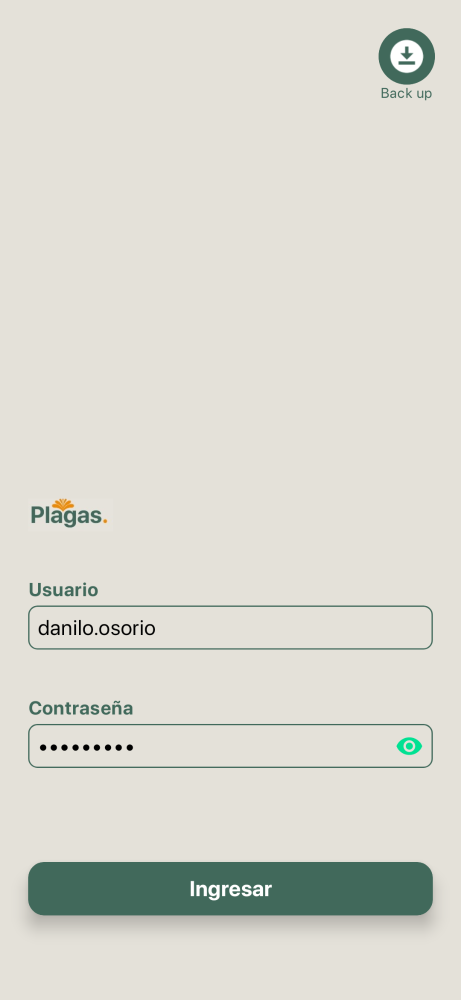</td>
<td>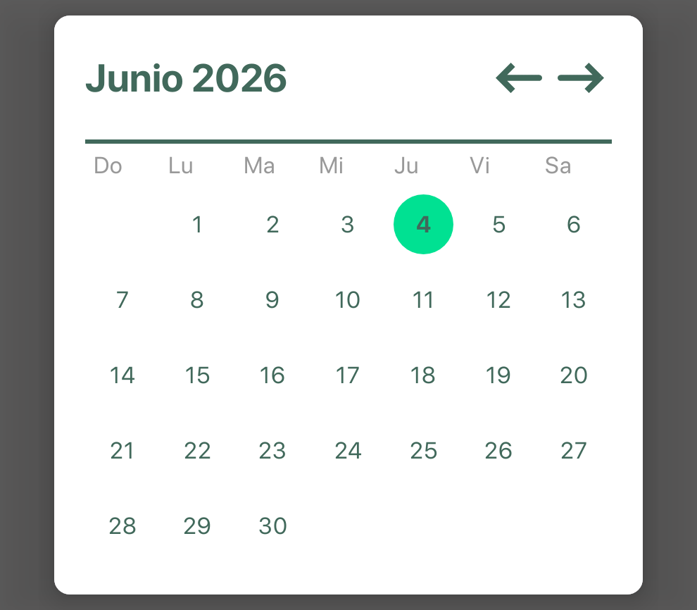</td>
<td>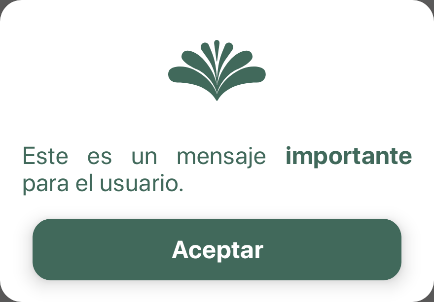</td>
</tr>
</table>

</div>

---

## Table of contents

- [Installation](#installation)
- [Quick start](#quick-start)
- [Theming](#theming)
  - [Colors](#colors)
  - [Typography](#typography)
- [Components](#components)
  - [Buttons](#buttons)
  - [Text fields](#text-fields)
  - [Spinners & dropdowns](#spinners--dropdowns)
  - [Selection controls](#selection-controls)
  - [Display & layout](#display--layout)
  - [Navigation](#navigation)
  - [Lists, items & labels](#lists-items--labels)
  - [Date & filters](#date--filters)
  - [Dialogs](#dialogs)
  - [Screens](#screens)
- [Generating the screenshots](#generating-the-screenshots)
- [Building from source](#building-from-source)
- [License](#license)

---

## Installation

The library is published through [JitPack](https://jitpack.io/#Capiro-Dev/CapiroUI).

**1. Add the JitPack repository** to your `settings.gradle` (or root `build.gradle`):

```groovy
dependencyResolutionManagement {
    repositories {
        google()
        mavenCentral()
        maven { url 'https://jitpack.io' }
    }
}
```

**2. Add the dependency** to your module `build.gradle`:

```groovy
dependencies {
    implementation 'com.github.Capiro-Dev:composables:1.12.55'
}
```

> The version must match a published git tag / JitPack build. Check the badge above for the latest available version.

**Requirements:** `minSdk 26`, Jetpack Compose, JDK 17.

---

## Quick start

Every component is stateless and driven by parameters + callbacks — hoist the state in your composable and pass it down:

```kotlin
import com.capiro.composables.athomic_composables.buttons.ButtonCapiro
import com.capiro.composables.athomic_composables.textfield.TextFieldOutlinedCapiro

@Composable
fun LoginForm() {
    var user by remember { mutableStateOf("") }

    Column {
        TextFieldOutlinedCapiro(
            textInput = user,
            label = "Usuario",
            onTextChangeEvent = { user = it },
        )
        ButtonCapiro(text = "Ingresar", onClick = { /* ... */ })
    }
}
```

---

## Theming

Capiro UI ships its own brand palette and typography rather than relying on `MaterialTheme.colorScheme`. Components reference these tokens directly, so they look consistent without any theme setup on your side.

### Colors

Defined in [`theme/Colors.kt`](composables/src/main/java/com/capiro/composables/theme/Colors.kt). `GreenCapiro` is the brand primary used across almost every component.

| Swatch | Token | Hex |
|:---:|---|---|
|  | `GreenCapiro` *(primary)* | `#41695B` |
|  | `GreenSecondCapiro` *(accent)* | `#00E192` |
|  | `BeigeCapiro` | `#E4E1D9` |
|  | `OrangeCapiro` | `#F18A00` |
|  | `GrayClearCapiro` | `#F0EEEE` |
|  | `GrayCapiro` | `#DAD6CB` |
|  | `GrayDarkCapiro` | `#999999` |
|  | `BlackCapiro` | `#505050` |
|  | `WhiteCapiro` | `#FFFFFF` |
|  | `RedCapiro` | `#CC1111` |
|  | `ErrorCapiro` | `#F72129` |

```kotlin
import com.capiro.composables.theme.GreenCapiro
import com.capiro.composables.theme.OrangeCapiro

Text("Hola", color = GreenCapiro)
```

### Typography

Typography is built on a custom **SF Pro Display** font family and the Material 3 type scale, defined in [`theme/Type.kt`](composables/src/main/java/com/capiro/composables/theme/Type.kt). It **auto-scales by screen width**: devices ≤ 400dp wide get the base scale, wider devices get a larger scale.

```kotlin
import getTypography          // composable contexts
import TypographyProvider     // non-composable / static contexts

Text("Título", style = getTypography().titleLarge)
Text("Cuerpo", style = TypographyProvider.typography.bodyMedium)
```

> `getTypography()` and `TypographyProvider` live in the default package, so they are imported without a package prefix.

---

## Components

> All previews below are generated automatically from the real composables — see [Generating the screenshots](#generating-the-screenshots).
>
> 📖 Looking for every parameter? See the full **[API reference →](docs/COMPONENTS.md)**. To browse the components live on a device, run the demo app (`:app`), which renders the [interactive gallery](app/src/main/java/com/capiro/capiroui/ComponentGallery.kt).

### Buttons

| Preview | Component | Description |
|:---:|---|---|
| 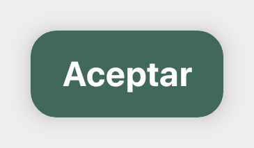 | `ButtonCapiro` | Primary rounded button with enabled/disabled states and fully configurable colors. |
| 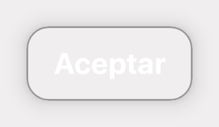 | `ButtonCapiro` *(disabled)* | The same button in its disabled state (`isEnabled = false`). |
| 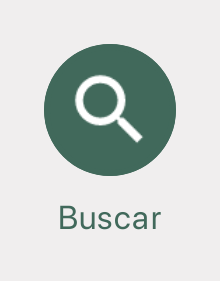 | `ButtonIconCapiro` | Icon button with an optional label and color changes on press. |
| 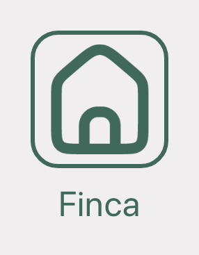 | `ButtonImageCapiro` | Image button with optional label and a locked/disabled indicator. |
| 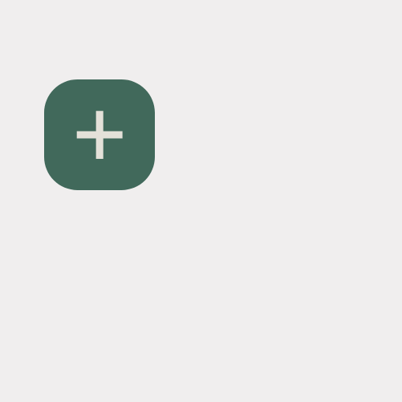 | `ButtonFabCapiro` | Floating action button with up to three expandable menu actions. |
| 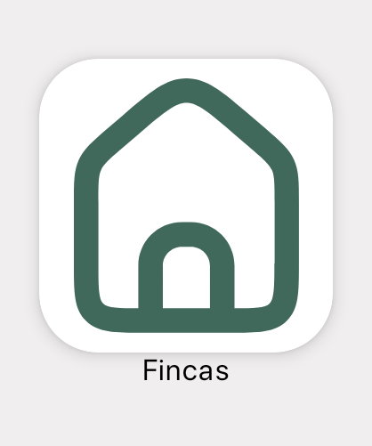 | `ButtonMenu` | Large menu tile (image + title) built from a `MenuItemCapiro`. |

<details><summary>💻 Usage</summary>

```kotlin
ButtonCapiro(text = "Aceptar", onClick = { })
ButtonCapiro(text = "Aceptar", onClick = { }, isEnabled = false)

ButtonIconCapiro(image = Icons.Filled.Search, onClick = { }, label = "Buscar")

ButtonImageCapiro(imageRes = R.drawable.farm, onClick = { }, size = 72.dp, label = "Finca")

ButtonFabCapiro(imageRes1 = R.drawable.fab, onClick1 = { }, innerPadding = 0.dp, iconSize = 56.dp)

ButtonMenu(
    menuItem = MenuItemCapiro(
        image = R.drawable.farm, title = "Fincas",
        borderColor = GreenCapiro, colorBack = WhiteCapiro, execute = { },
    ),
    size = 120.dp,
)
```
</details>

### Text fields

| Preview | Component | Description |
|:---:|---|---|
| 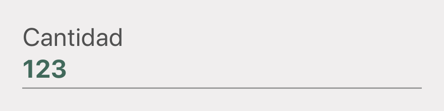 | `TextFieldCapiro` | Labeled text field with a trailing lock icon when disabled. |
| 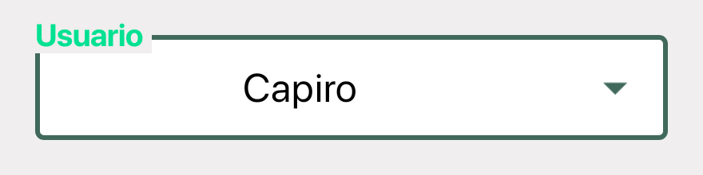 | `TextFieldOutlinedCapiro` | Outlined field with password support and optional leading/trailing icons. |
| 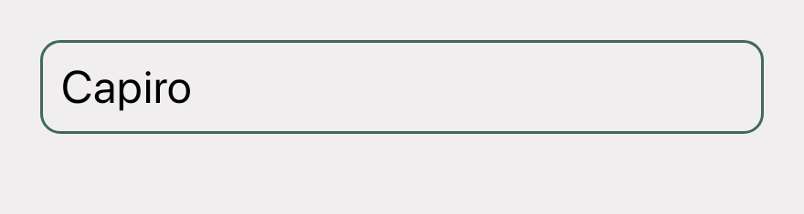 | `TextFieldRoundedBorderCapiro` | Rounded-border field with inline error message and password toggle. |
| 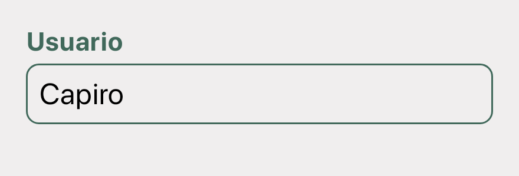 | `TextFieldAndTileRoundedBorderCapiro` | Rounded-border field with a title label above it. |
| 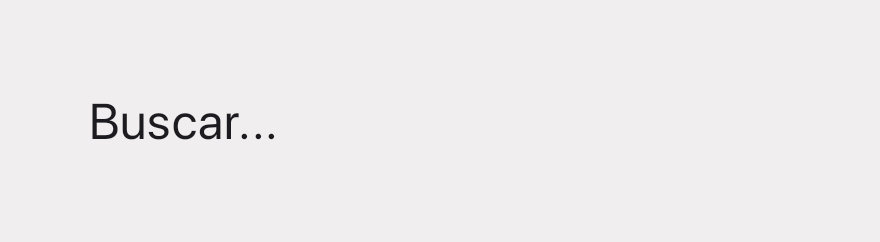 | `TextFieldSolidBackground` | Borderless field with a solid background, used for search inputs. |

<details><summary>💻 Usage</summary>

```kotlin
var text by remember { mutableStateOf("") }

TextFieldCapiro(textInput = text, label = "Cantidad", onTextChangeEvent = { text = it })

TextFieldOutlinedCapiro(textInput = text, label = "Usuario", onTextChangeEvent = { text = it })

TextFieldRoundedBorderCapiro(textInput = text, onTextChangeEvent = { text = it }, label = "Usuario")

TextFieldAndTileRoundedBorderCapiro(
    textInput = text, onTextChangeEvent = { text = it }, label = "Usuario", title = "Usuario",
)

TextFieldSolidBackground(text = text, onTextChanged = { text = it })
```
</details>

### Spinners & dropdowns

| Preview | Component | Description |
|:---:|---|---|
| 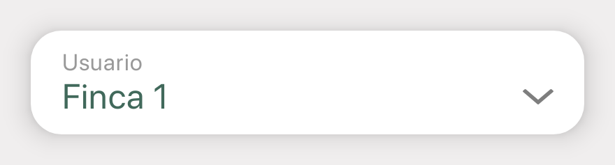 | `SpinnerButtonCapiro` | Clickable spinner showing the selected item (or placeholder) with a label. |
| 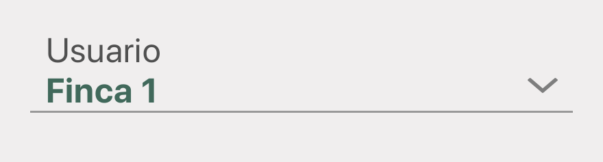 | `SpinnerButtonUnderlined` | Underlined spinner button with an optional error state. |
| 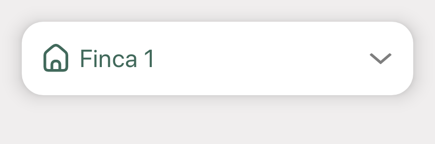 | `SpinnerDropdownCapiro` | Dropdown with a leading image and an expandable list of items. |
|  | `SpinnerDropdownUnderlined` | Underlined dropdown with an optional label and error state. |
| 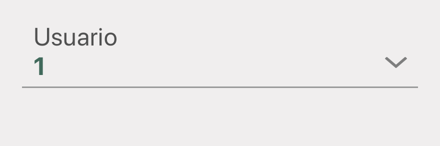 | `SimpleDropdownTextCapiro` | Dropdown that includes a custom "otro" (other) free-text option. |
| 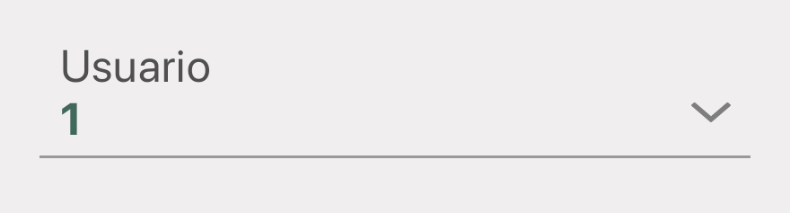 | `SimpleDropDownUnderlined` | Minimal underlined dropdown field with a down arrow. |

<details><summary>💻 Usage</summary>

```kotlin
val items = listOf("Finca 1", "Finca 2")
var selected by remember { mutableStateOf(items.first()) }

SpinnerButtonCapiro(itemSelected = selected, labelResourceId = R.string.label, onClick = { })

SpinnerButtonUnderlined(labelResourceId = R.string.label, selectedItem = selected, onClick = { })

SpinnerDropdownCapiro(
    imageResourceId = R.drawable.farm, items = items,
    selectedItem = selected, onItemSelect = { selected = it },
)

SpinnerDropdownUnderlined(
    items = items, selectedItem = selected,
    onItemSelectedChange = { selected = it }, labelResourceId = R.string.label,
)

SimpleDropdownTextCapiro(
    items = items, selectedItem = selected,
    onItemSelect = { selected = it }, labelResourceId = R.string.label,
)

SimpleDropDownUnderlined(labelResourceId = R.string.label, selectedItem = selected, onClick = { })
```
</details>

### Selection controls

| Preview | Component | Description |
|:---:|---|---|
| 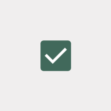 | `CheckBoxCapiro` | Branded checkbox with a configurable scale and enabled state. |
| 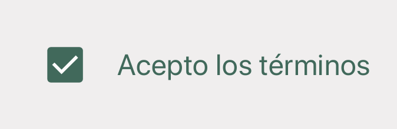 | `CheckBoxAndTextCapiro` | Checkbox with an accompanying text label. |
|  | `RadioButtonCapiro` | Radio button driven by `selection`/`identifier` equality. |
|  | `RadioButtonTextCapiro` | Radio button with a text label. |
| 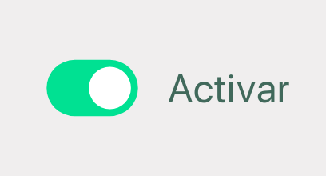 | `SwitchCapiro` | Toggle switch with a text label. |

<details><summary>💻 Usage</summary>

```kotlin
var checked by remember { mutableStateOf(true) }
var choice by remember { mutableStateOf("A") }

CheckBoxCapiro(isChecked = checked, onCheckedChange = { checked = it })

CheckBoxAndTextCapiro(isChecked = checked, onSelectedItemChange = { }, text = "Acepto los términos")

RadioButtonCapiro(selection = choice, identifier = "A", onClick = { choice = it })

RadioButtonTextCapiro(selection = choice, identifier = "Opción A", onClick = { choice = it })

SwitchCapiro(text = "Activar", isChecked = checked, onCheckedChange = { checked = it })
```
</details>

### Display & layout

| Preview | Component | Description |
|:---:|---|---|
| 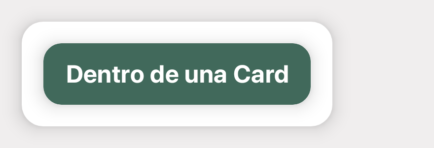 | `CardCapiro` | Rounded, elevated container with inner padding for any content. |
|  | `ImageCapiro` | Displays a drawable resource with fit scaling. |
| 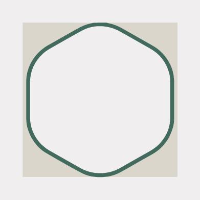 | `PolygonCapiro` | Hexagonal shape, optionally hosting image content (e.g. profile photos). |
| 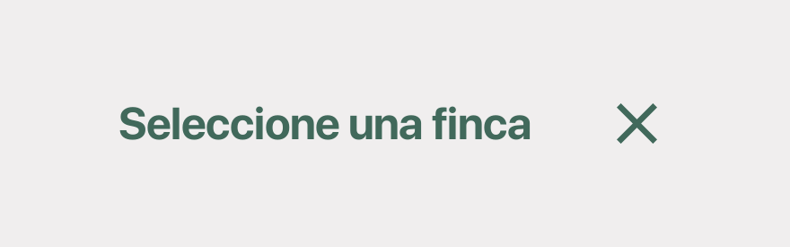 | `DialogTitle` | Centered dialog title with an optional close button. |
|  | `DialogTitle2` | Centered image header with rounded corners for dialogs. |

<details><summary>💻 Usage</summary>

```kotlin
CardCapiro(innerComposable = { Text("Contenido") })

ImageCapiro(imageSourceId = R.drawable.logo, modifier = Modifier.size(120.dp))

PolygonCapiro(modifier = Modifier.size(110.dp))

DialogTitle(text = "Seleccione una finca", onCloseClick = { })

DialogTitle2(imageResource = R.drawable.flower)
```
</details>

### Navigation

| Preview | Component | Description |
|:---:|---|---|
| 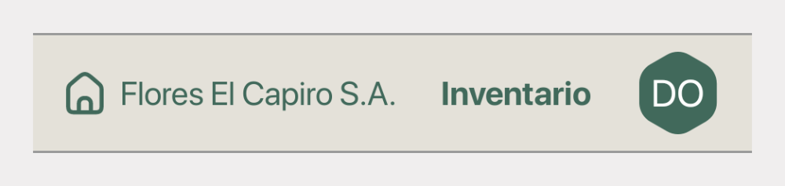 | `ToolbarCapiro` | App toolbar with farm name, section title and a user-menu button that opens the account dialog. |
| 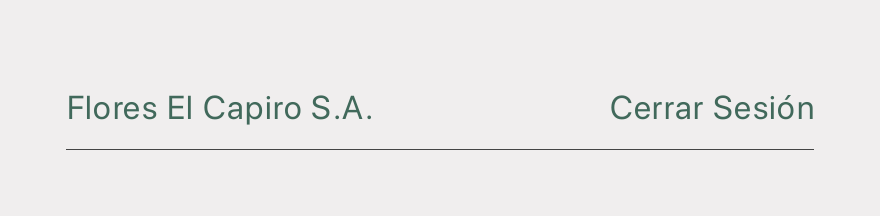 | `CurrentAccountMenuTopBar` | Top bar of the account menu with a "close session" action. |
| 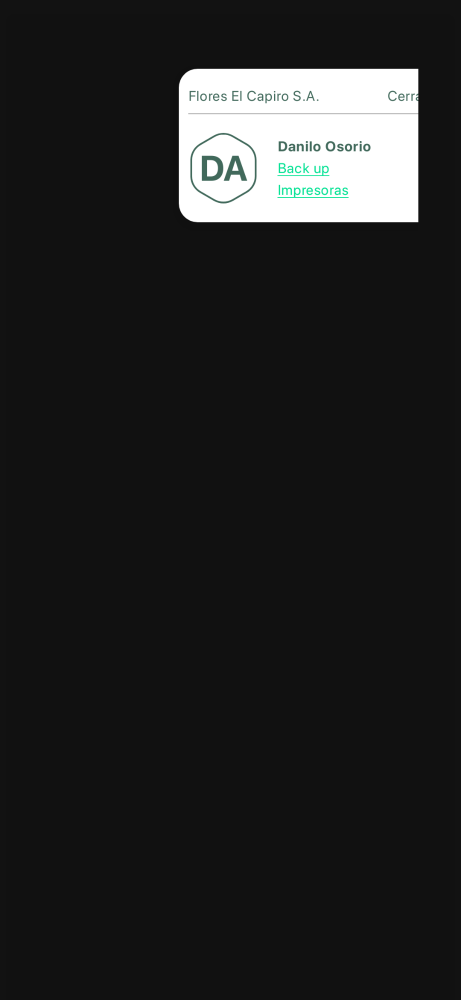 | `ToolbarMenuLayoutDialogCapiro` | Account options dialog (logout / backup / printers). |

<details><summary>💻 Usage</summary>

```kotlin
ToolbarCapiro(
    user = "Danilo Osorio",
    farm = "Flores El Capiro S.A.",
    section = "Inventario",
    userAbbreviation = "DO",
    onLogoutClick = { },
    onBackUpClick = { },
    onPrintersClick = { },
)

var menuOpen by remember { mutableStateOf(false) }
ToolbarMenuLayoutDialogCapiro(
    user = "Danilo Osorio",
    isOpenDialog = menuOpen,
    onCloseDialog = { menuOpen = false },
    onLogoutClick = { },
)
```
</details>

### Lists, items & labels

| Preview | Component | Description |
|:---:|---|---|
| 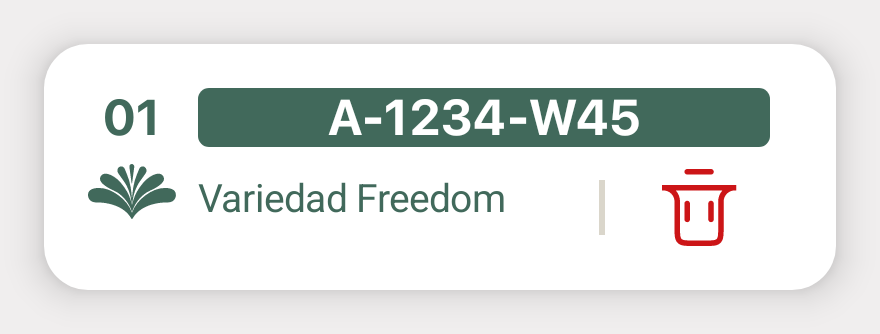 | `ItemManualCapiro` | Scanned-item row with number, label, custom content and optional delete. |
| 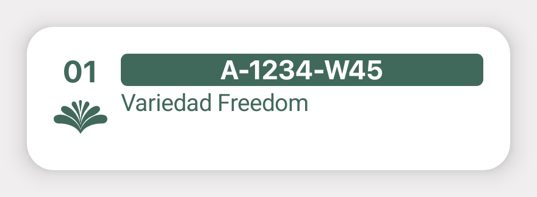 | `ItemScannerCapiro` | Scanned-item row with number, label, custom content and optional expand. |
| 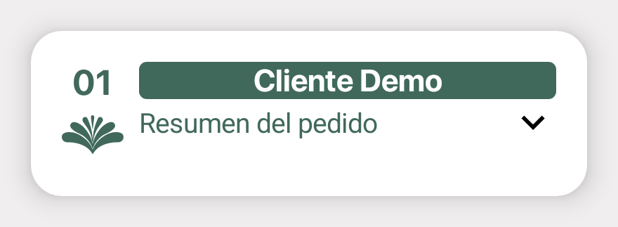 | `ItemExpandableCapiro` | Expandable item card that reveals a list of variety details. |
| 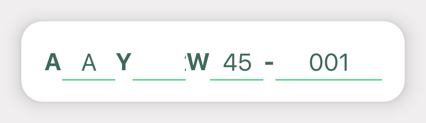 | `LabelManualCapiro` | A/Y/W + consecutive manual label entry fields (farm & week variants available). |

<details><summary>💻 Usage</summary>

```kotlin
ItemManualCapiro(
    itemNumber = "01", scannedLabel = "A-1234-W45",
    mainComposable = { Text("Variedad Freedom", color = GreenCapiro) },
    onDeleteClick = { },
)

ItemScannerCapiro(
    itemNumber = "01", scannedLabel = "A-1234-W45",
    mainComposable = { Text("Variedad Freedom", color = GreenCapiro) },
    color = GreenCapiro, colorBackground = WhiteCapiro,
)

ItemExpandableCapiro(
    itemNumber = "01", customer = "Cliente Demo",
    mainComposable = { Text("Resumen", color = GreenCapiro) },
    listVarieties = listOf(VarietyReport(variety = "Freedom", stems = 120, bouquets = 10)),
    color = GreenCapiro, colorBackground = WhiteCapiro,
)

LabelManualCapiro(
    textValueA = "A", textValueY = "2024", textValueW = "45", textConsecutive = "001",
    onTextChangeA = { }, onTextChangeY = { }, onTextChangeW = { },
    itemsY = listOf("2024", "2025"), itemsW = listOf("44", "45"),
    onTextChangeConsecutive = { },
)
```
</details>

### Date & filters

| Preview | Component | Description |
|:---:|---|---|
|  | `CalendarBarCapiro` | Date bar showing day / weekday / month with a calendar trigger. |
| 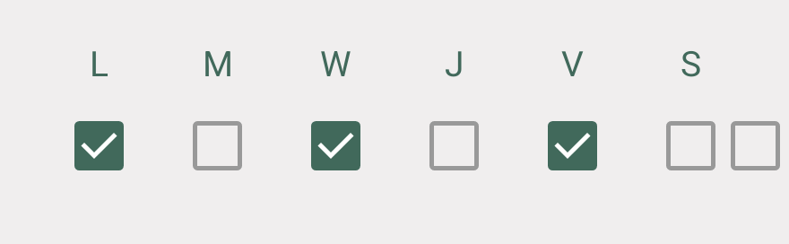 | `WeekFilterCapiro` | Row of day checkboxes for filtering by weekday. |
| 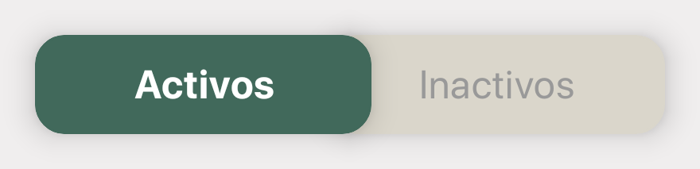 | `TwoOptionsButtonCapiro` | Two mutually-exclusive toggle buttons (only one active at a time). |

<details><summary>💻 Usage</summary>

```kotlin
CalendarBarCapiro(day = "04", dayOfWeek = "Jueves", month = "Junio", onCalendarClick = { })

val days = remember {
    mutableStateOf(linkedMapOf("L" to true, "M" to false, "W" to true, "J" to false,
        "V" to true, "S" to false, "D" to false))
}
WeekFilterCapiro(
    daysChecked = days.value,
    onDayCheckedChange = { day, checked -> days.value = days.value.toMutableMap().apply { this[day] = checked } },
)

TwoOptionsButtonCapiro(text1 = "Activos", text2 = "Inactivos", onClick1 = { }, onClick2 = { })
```
</details>

### Dialogs

All dialogs follow the same pattern: pass an `isOpen` boolean and they render nothing while closed.

| Preview | Component | Description |
|:---:|---|---|
| 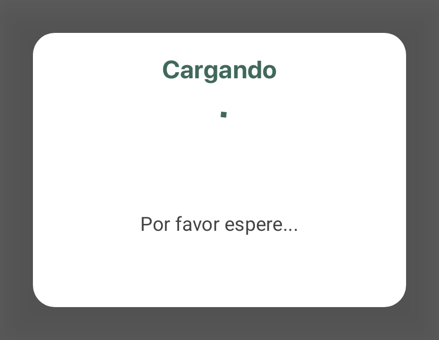 | `LoadingDialog` | Blocking loading dialog with a title, message and spinner. |
|  | `OneOptionDialogCapiro` | Single-action dialog with an image and (optionally bolded) message. |
| 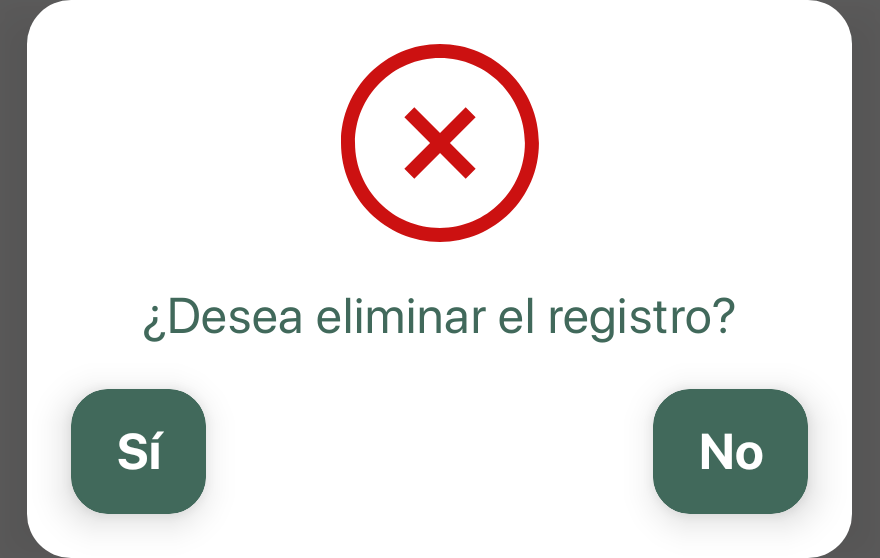 | `TwoOptionsDialogCapiro` | Confirm/cancel dialog with two buttons. |
|  | `CustomDatePicker` | Custom calendar date picker with optional date-range limiting. |
| 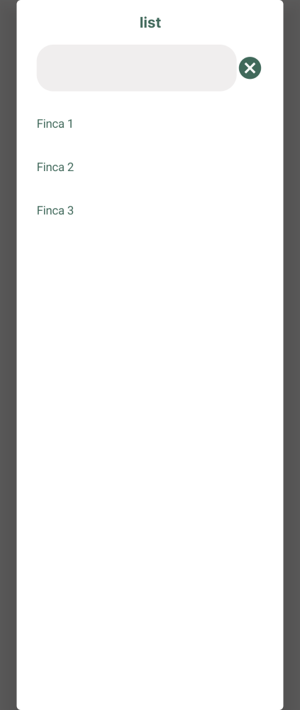 | `SearchListDialogCapiro<T>` | Generic searchable list dialog with a caller-supplied item slot. |
| 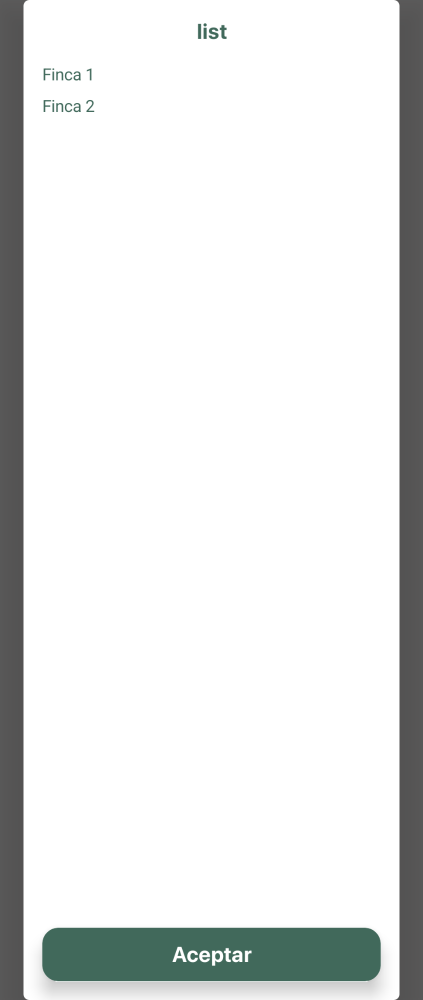 | `SimpleListDialogsCapiro<T>` | Generic list dialog with a custom item slot. |
| 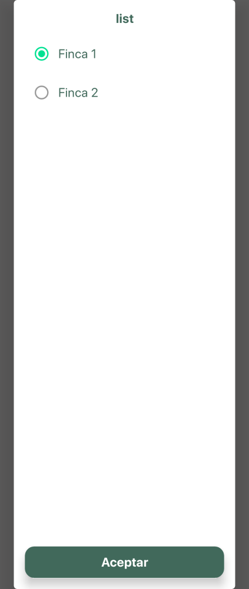 | `RadioButtonDialogCapiro` | Dialog with a list of radio-button options. |
| 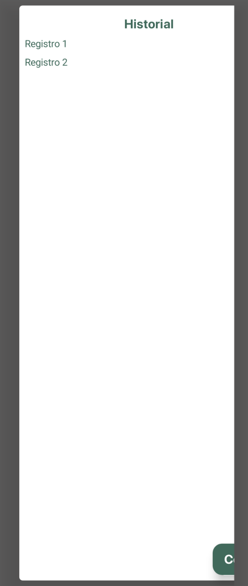 | `SimpleDialogHistoryCapiro<T>` | Generic list dialog with a title and close button. |
| 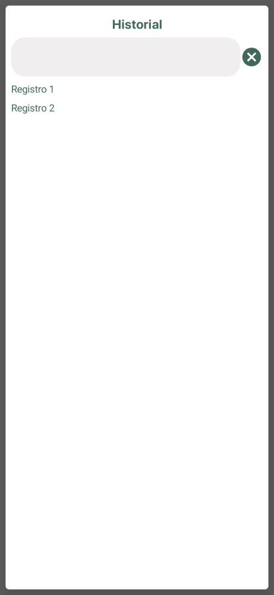 | `DialogHistoryCapiro<T>` | Searchable history dialog with a built-in week filter. |
| 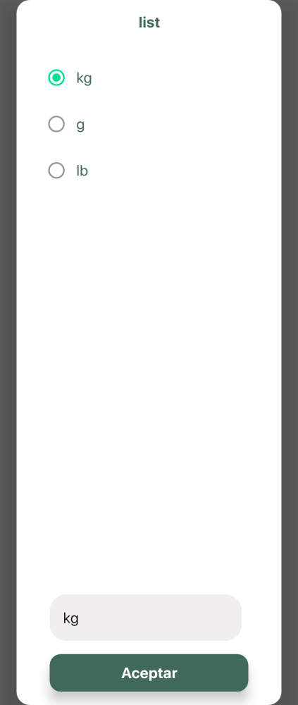 | `ListTextFieldDialogCapiro` | Dialog combining a selectable list with a text/units input. |
| 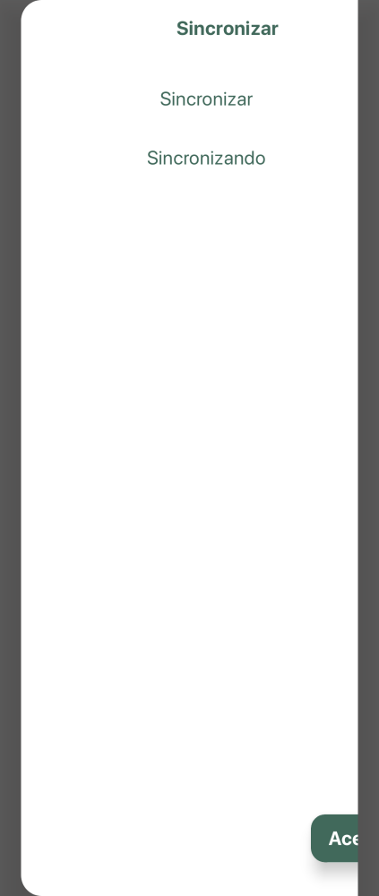 | `SyncDialogCapiro` | Progress dialog showing the status of multiple sync items. |

<details><summary>💻 Usage</summary>

```kotlin
var open by remember { mutableStateOf(true) }

LoadingDialog(isDialogOpenState = open, title = "Cargando", message = "Por favor espere...", onClose = { open = false })

OneOptionDialogCapiro(
    imaResource = R.drawable.flower, boldText = "importante",
    message = "Este es un mensaje importante.", positiveButtonText = "Aceptar",
    onPositiveButtonClickEvent = { open = false }, isDialogOpenState = open,
)

TwoOptionsDialogCapiro(
    imaResource = R.drawable.error, message = "¿Desea eliminar el registro?",
    positiveButtonText = "Sí", negativeButtonText = "No",
    onPositiveButtonClickEvent = { }, onNegativeButtonClickEvent = { open = false },
    isDialogOpenState = open,
)

CustomDatePicker(isOpenDialog = open, onDateSelected = { }, onCloseDialog = { open = false })

// Generic, slot-based list dialog
SimpleListDialogsCapiro(
    titleIdRes = R.string.title, isTheDialogOpenState = open,
    allData = arrayOf("Finca 1", "Finca 2"), onCloseDialogEvent = { open = false },
    items = { Text(it, color = GreenCapiro) },
)

SearchListDialogCapiro(
    searchText = "", onSearchTextChange = { }, titleIdRes = R.string.title,
    isTheDialogOpenState = open, allData = arrayOf("Finca 1", "Finca 2"),
    onCleanText = { }, onSearchItemSelectedChangeState = { }, onCloseDialogEvent = { open = false },
    item = { Text(it, color = GreenCapiro) },
)
```
</details>

### Screens

Full-screen composables ready to host in an `Activity` / nav destination.

| Preview | Component | Description |
|:---:|---|---|
| 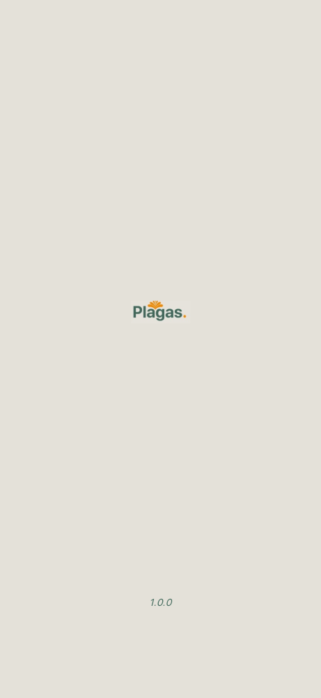 | `SplashScreenCapiro` | Splash screen with app icon, support message and version. |
|  | `LoginScreenCapiro` | Login screen with user/password fields, backup and login actions. |

<details><summary>💻 Usage</summary>

```kotlin
SplashScreenCapiro(iconAppResource = R.drawable.logo, version = "1.0.0")

var user by remember { mutableStateOf("") }
var password by remember { mutableStateOf("") }
LoginScreenCapiro(
    iconAppResource = R.drawable.logo,
    onBackUpClick = { },
    user = user, password = password,
    onUserTextChange = { user = it },
    onPasswordTextChange = { password = it },
    onLoginClick = { },
)
```
</details>

---

## Generating the screenshots

Every preview in this README is rendered directly from the library composables using [Paparazzi](https://github.com/cashapp/paparazzi) — no device or emulator required. The snapshot tests live in [`composables/src/test/java/com/capiro/composables/`](composables/src/test/java/com/capiro/composables/) (`ScreenshotTest`, `ScreenScreenshotTest`).

```bash
# Record / update the golden images
./gradlew :composables:recordPaparazziDebug

# Verify nothing changed (useful in CI)
./gradlew :composables:verifyPaparazziDebug
```

Golden images are written to `composables/src/test/snapshots/images/` and copied into [`docs/screenshots/`](docs/screenshots/) for this document. Add a new `@Test` to render any new component.

> 💡 **Ideas for the future:** wire `verifyPaparazziDebug` into CI to catch unintended visual regressions on every PR, and consider hosting an interactive component gallery (e.g. a Compose showcase app or a published Storybook-style page).

---

## Building from source

```bash
./gradlew :composables:assembleDebug        # build the library
./gradlew :composables:publishToMavenLocal  # publish locally for testing
```

This project targets **JDK 17** (AGP 8.4.1). If Gradle picks up an older JDK, point it at a 17+ runtime, e.g. Android Studio's bundled JBR:

```bash
# Windows (PowerShell)
$env:JAVA_HOME = "C:\Program Files\Android\Android Studio\jbr"
```

---

## License

No open-source license is currently declared for this repository. It is maintained by **Flores El Capiro S.A.**; add a `LICENSE` file to clarify usage terms for external consumers.
